# Windows Service & Process Monitoring Agent

A defensive endpoint-detection project for Windows. It inventories processes, services, startup entries and scheduled
tasks, enriches every executable with a **SHA-256 hash and Authenticode signature**, and applies **30 detection rules
mapped to MITRE ATT&CK** to find malicious parent-child chains, masquerading, persistence, privilege-escalation
weaknesses and suspicious command lines. Findings are correlated, scored, and delivered as CSV/JSON/HTML reports and an
interactive dashboard.

**Live dashboard:** https://windows-service-process-monitor.streamlit.app/

> Defensive use only - run it on systems you are authorised to monitor.

## Walkthrough video


https://github.com/user-attachments/assets/9e40553f-25e2-419d-bd1a-db0be43c882f


A guided tour of the real application, in seven scenes:

| # | Scene | What you see |
|---|---|---|
| 1 | The security console | Severity-ranked alerts and the highest-risk entities |
| 2 | Run the agent | One command: inventory, signature checks and 30 detection rules |
| 3 | Investigate an alert | Why it fired, the ATT&CK technique, the evidence and the recommended response |
| 4 | Process tree | Attack chains flagged (Word → cmd → PowerShell, a fake `svchost.exe`) |
| 5 | Services & persistence | New / changed / unquoted / weakly-permissioned services, startup items, tasks |
| 6 | MITRE ATT&CK | Every finding mapped to a technique; the 30-rule catalog |
| 7 | A real workstation | Signature-aware allowlisting keeps the noise near zero |

Scenes 1 and 3-6 use the safe `--demo` attack simulation (nothing malicious is executed); scene 7 is a scan of a real
machine.

## Highlights

| Area | What it does |
|---|---|
| **Parent-child monitor** | PID/PPID lineage with PID-reuse protection; 350+ suspicious parent-child pairs across 35 parent processes (Office/PDF, browsers, script hosts, WMI, web servers, spooler, accessibility tools) |
| **Process integrity** | Critical-process location + parent validation (`svchost`, `lsass`, `services` ...), duplicate singletons, look-alike names (`scvhost.exe`), double extensions, deleted images, SYSTEM processes from odd paths |
| **Unauthorized processes** | Allowlist **and** blacklist (40+ offensive tools / miners), unsigned-binary detection, SHA-256 IOC matching, staging-directory execution |
| **Service audit** | New / modified / removed services vs a baseline, unquoted paths, binary in user-writable folder, **weak ACLs on binary, folder and registry key**, unsigned binaries, PsExec-style services |
| **Persistence** | Run/RunOnce keys, Startup folders (shortcuts resolved), scheduled tasks - new or suspicious |
| **Command-line analysis** | Encoded PowerShell, download cradles, LOLBin abuse, shadow-copy deletion, LSASS dumping, Defender tampering, log clearing ... |
| **Correlation** | Independent signals on one entity, and descendants of an alerting parent, are escalated (CORR-001) |
| **Reporting** | `alerts.json/csv`, summary JSON, per-inventory CSVs, self-contained **HTML report**, daily log files, trend history |
| **Operations** | `--watch` continuous mode, baseline workflow, analyst suppressions, `--fail-on` exit codes for automation, privacy redaction |
| **Quality** | 63 unit tests, CI on Windows, headless dashboard test, safe `--demo` attack simulation |

Measured on a real workstation (300+ processes, 295 services): **a handful of informational alerts** instead of 183 raw
"unknown process" alerts from a plain allowlist, thanks to signature-aware allowlisting.

## Architecture

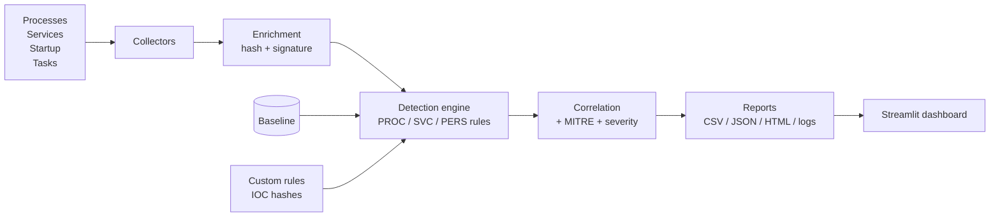

More detail: [`docs/architecture.md`](docs/architecture.md), [`docs/flowchart.md`](docs/flowchart.md),
[`docs/detection_rules.md`](docs/detection_rules.md) (auto-generated rule reference).

## Quick start

```bash
git clone https://github.com/NitinSukthe-G/Windows-Service-Process-Monitor.git
cd Windows-Service-Process-Monitor
python -m venv venv
venv\Scripts\activate
pip install -r requirements.txt
```

```bash
python agent\monitor.py                   # full scan -> reports\
python agent\monitor.py --demo            # safe synthetic attack scenario -> reports\demo\
python agent\monitor.py --watch           # continuous monitoring (CTRL+C to stop)
streamlit run dashboard\app.py            # dashboard at http://localhost:8501
```

Run from an **elevated** terminal for full visibility (protected processes, service ACLs). The first scan verifies
signatures and takes about a minute; results are cached afterwards (~20 s for a full scan, ~1 s per `--watch` cycle).

## Dashboard

A dark-themed Streamlit console (`dashboard/app.py`, theme in `.streamlit/config.toml`) that reads the report files:

| Tab | Content |
|---|---|
| **Overview** | KPIs, alerts by severity and type, highest-risk entities, process trust posture, alert trend across scans |
| **Alerts** | Filter by severity / type / text; drill-down with the reason, MITRE technique, evidence and recommended response; CSV download |
| **Processes** | Parent → child tree with flagged branches (🟥 critical ... 🟩 low) and a searchable inventory with signature / trust columns |
| **Services** | Flagged services plus the full inventory (state, start mode, account, signature) |
| **Persistence** | Startup entries, scheduled tasks and their alerts |
| **MITRE & Rules** | ATT&CK techniques observed and the full 30-rule catalog |
| **About** | Scan details and downloads (HTML report, alerts and summary JSON) |

Use the sidebar to switch between the **live scan** of the machine and the **demo attack scenario**. The deployed app
shows the report files committed in `reports/`; run the agent locally to refresh them.

### Command-line options

| Option | Purpose |
|---|---|
| `--watch [--interval N]` | Continuous monitoring; announces new processes and new alerts |
| `--demo` | Run the real engine on synthetic attacks (nothing is executed) |
| `--view processes\|tree\|services\|startup` | Print raw inventories / the process tree |
| `--update-baseline` | Accept the current services, startup entries and tasks as normal |
| `--list-rules` | Print the rule catalog |
| `--min-severity`, `--top N` | Console output filters |
| `--fail-on SEVERITY` | Exit with code 2 when an alert at/above this level exists (CI / scheduled use) |
| `--no-signatures`, `--no-tasks`, `--quick` | Faster, lighter scans |
| `--no-redact` | Keep real user/computer names in reports (redacted by default) |

## Example output (`--demo`)

```text
   CRITICAL  PROC-004  mimikatz.exe PID 3200  [T1003]
      Process matches a blacklisted tool: mimikatz.exe (credential dumper).
      chain: System(4) > smss.exe(400) > winlogon.exe(560) > explorer.exe(1500) > mimikatz.exe(3200)
   CRITICAL  PROC-008  cmd.exe PID 3400  [T1490]
      Shadow copy / backup deletion (ransomware behaviour) detected in command line.
   CRITICAL  PROC-005  svchost.exe PID 3100  [T1036.005]
      svchost.exe should run from c:\windows\system32 but runs from C:\Users\Public.
   HIGH      PROC-001  cmd.exe PID 3010  [T1204.002]
      Office/PDF application spawned a shell or LOLBin (malicious macro / exploit): WINWORD.EXE -> cmd.exe
   CRITICAL  SVC-004  LegacyAgent  [T1543.003]
      Service 'LegacyAgent' changed since baseline (path: 'C:\Program Files\Legacy\agent.exe' -> 'C:\Users\Public\agent.exe').
```

## Detection coverage (summary)

Full table with descriptions and responses: [`docs/detection_rules.md`](docs/detection_rules.md).

| ID | Detection | ATT&CK |
|---|---|---|
| PROC-001 | Suspicious parent-child chain | T1204.002 / T1059 / T1047 / T1505.003 |
| PROC-002 | Execution from user-writable directory | T1036 |
| PROC-003 | Unsigned process not on allowlist | T1036 |
| PROC-004 | Blacklisted tool / malware name | T1003 |
| PROC-005 / 006 / 009 | System-process masquerading, look-alikes, duplicates | T1036.004 / T1036.005 |
| PROC-007 | Unexpected parent of critical process (injection / spoofing) | T1055 |
| PROC-008 | Suspicious command line (19 patterns) | T1059 / T1027 / T1490 / T1003.001 ... |
| PROC-010 / 011 / 012 / 013 / 014 | SYSTEM from odd path, deleted image, double extension, bad signature, IOC hash | T1543 / T1070.004 / T1036.007 / T1553.002 |
| SVC-001 ... 011 | Service path, unquoted path, drift, ACLs, signatures, interpreters, tools | T1543.003 / T1574.009-011 / T1569.002 |
| PERS-001 ... 004 | Startup entries and scheduled tasks | T1547.001 / T1053.005 |
| CORR-001 | Multiple independent indicators on one entity | - |

## Severity model

| Score | Severity | Meaning |
|---|---|---|
| 9-10 | CRITICAL | Near-certain malicious behaviour or several independent indicators |
| 6-8 | HIGH | Strong indicator - investigate promptly |
| 3-5 | MEDIUM | Unusual - investigate when time allows |
| 1-2 | LOW | Informational |

## Reports

Written to `reports/` (and `reports/demo/` for `--demo`):

| File | Content |
|---|---|
| `alerts.json` / `alerts.csv` | All alerts with rule, MITRE mapping, evidence (lineage, command line, hash, signature) and recommended response |
| `monitoring_summary.json` | Totals, severity counts, top rules, MITRE techniques, riskiest entities, trust posture |
| `process_report.csv`, `service_report.csv`, `startup_report.csv`, `scheduled_task_report.csv` | Full inventories with signature and hash columns |
| `detection_report.html` | Self-contained, printable executive report |
| `scan_history.jsonl` | One line per scan, drives the dashboard trend chart |

Logs are written to `logs/monitor-YYYY-MM-DD.log`; baselines and the signature cache live in `baseline/` (both are
git-ignored per machine). Reports are **redacted** (user and computer name) before writing.

## Tuning

* `config/custom_rules.json` - approved processes, extra blacklist entries, trusted services, suppressions.
* `config/ioc_hashes.txt` - known-bad SHA-256 hashes (match -> CRITICAL).
* `python agent\monitor.py --update-baseline` - after reviewing new services/startup items.

## Testing

```bash
python -m unittest discover -s tests -v      # 63 tests
```

The suite covers every rule family (true positives **and** false-positive guards such as signed software, packaged
apps and browser native-messaging hosts), baseline drift, correlation, suppression, report round-trips and HTML
escaping. CI (`.github/workflows/ci.yml`) also runs a live scan and renders the dashboard headlessly.

## Project structure

```text
Windows-Service-Process-Monitor/
├── agent/                       detection agent
│   ├── monitor.py               CLI entry point (scan, --watch, --demo, --view, ...)
│   ├── continuous_monitor.py    shortcut for `monitor.py --watch`
│   ├── collectors.py            processes, services, startup entries, scheduled tasks
│   ├── enrichment.py            SHA-256 + Authenticode signatures (cached)
│   ├── rules_data.py            rule catalog, allow/deny lists, MITRE technique map
│   ├── process_rules.py         PROC-001 ... 014
│   ├── service_rules.py         SVC-001 ... 011
│   ├── persistence_rules.py     PERS-001 ... 004
│   ├── alerts.py / engine.py    scoring, suppression, correlation, summary
│   ├── baseline.py              baseline snapshot for drift detection
│   ├── reporting.py             CSV / JSON / HTML writers + privacy redaction
│   ├── demo.py                  safe synthetic attack scenario
│   ├── config.py / pathutils.py settings and helpers
│   └── powershell/              signature, ACL, task, service and shortcut helpers
├── dashboard/app.py             Streamlit dashboard
├── config/                      custom_rules.json, ioc_hashes.txt
├── docs/                        architecture, flowcharts, generated rule reference, project report (PDF)
├── tests/                       63 unit tests
├── tools/gen_rule_docs.py       regenerates docs/detection_rules.md from the rule catalog
├── reports/                     latest live scan + demo scenario (reports/demo/)
├── screenshots/                 evidence screenshots (dark theme)
├── .streamlit/config.toml       dashboard theme
├── .github/workflows/ci.yml     CI: tests, demo, live smoke scan, dashboard render
├── Windows_Service_Process_Monitor_walkthrough.mp4   narrated walkthrough video
├── requirements.txt
└── README.md
```

## Screenshots

### Dashboard
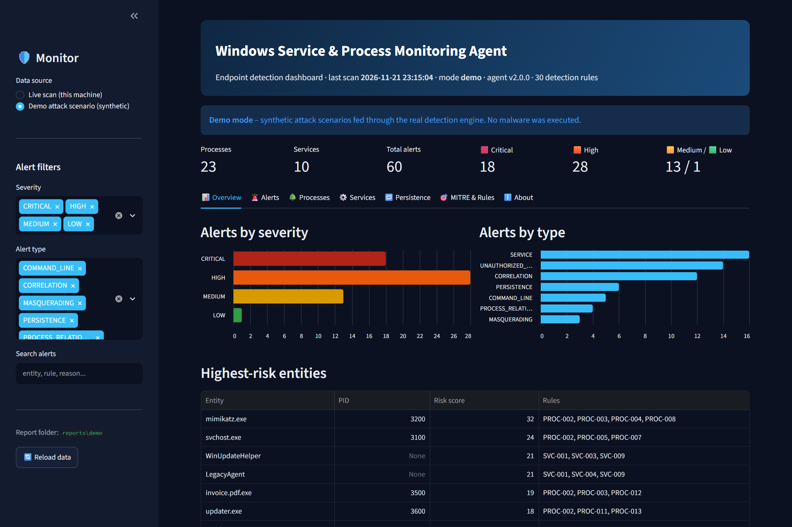
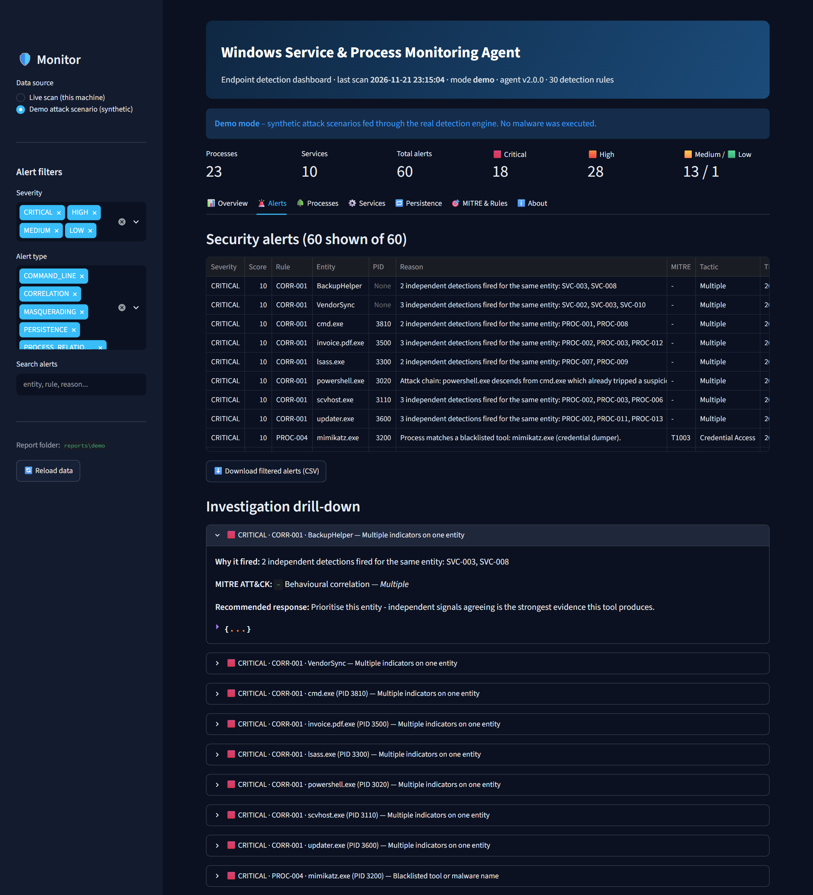
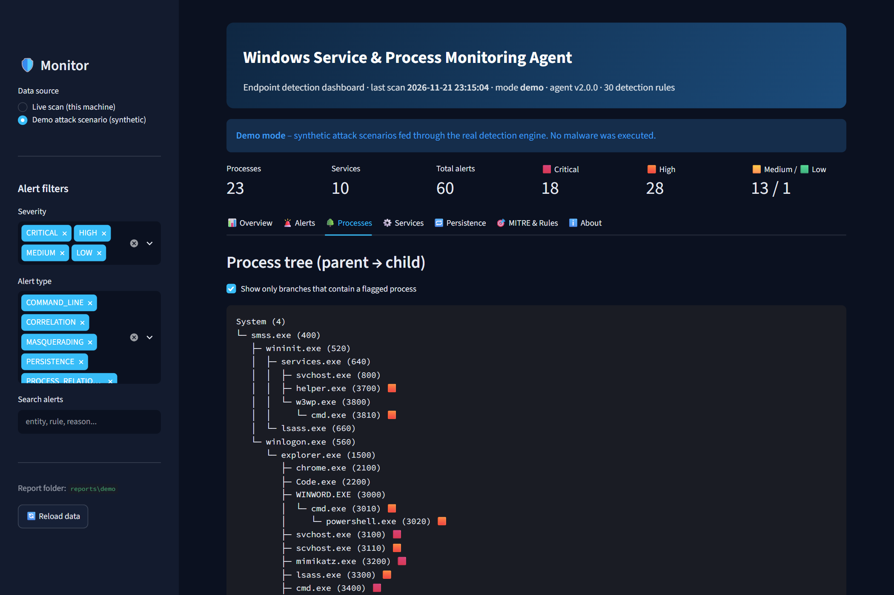
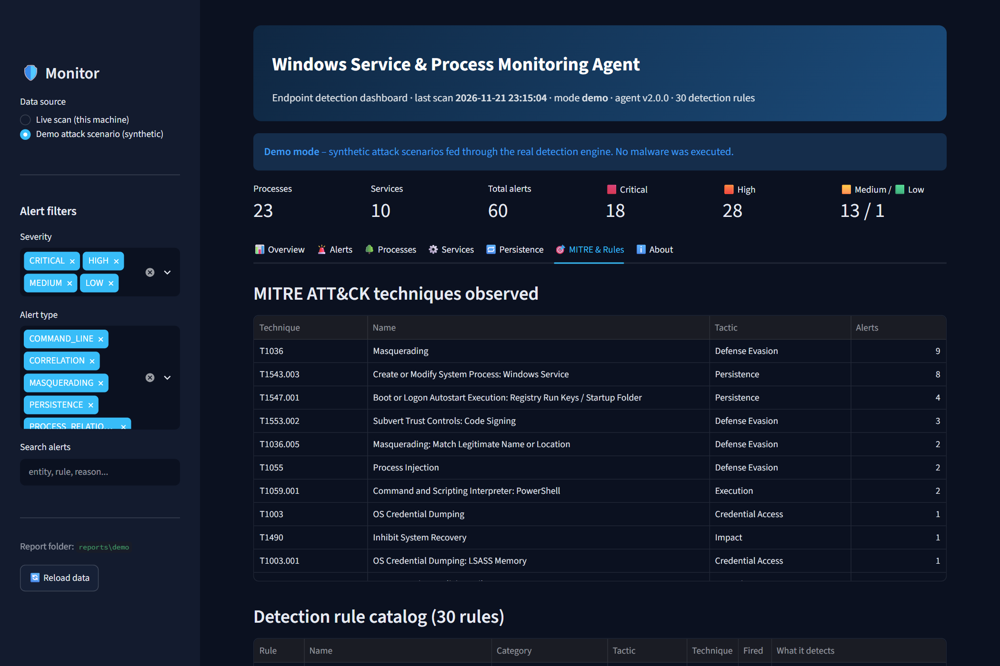

### Command line
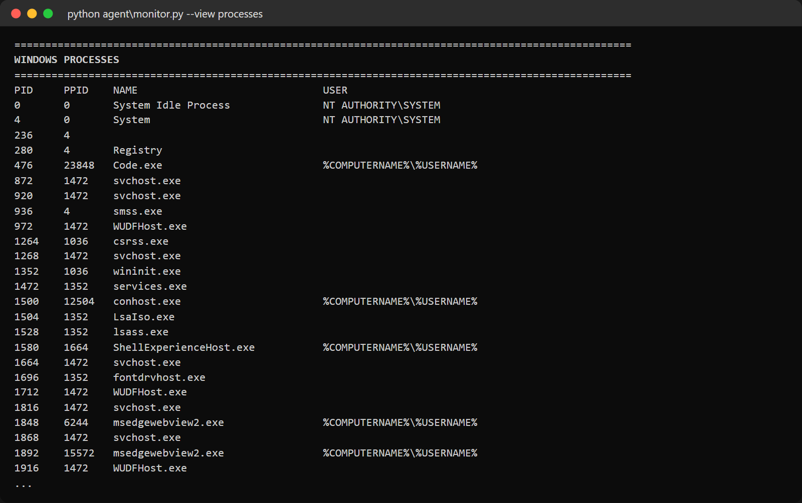
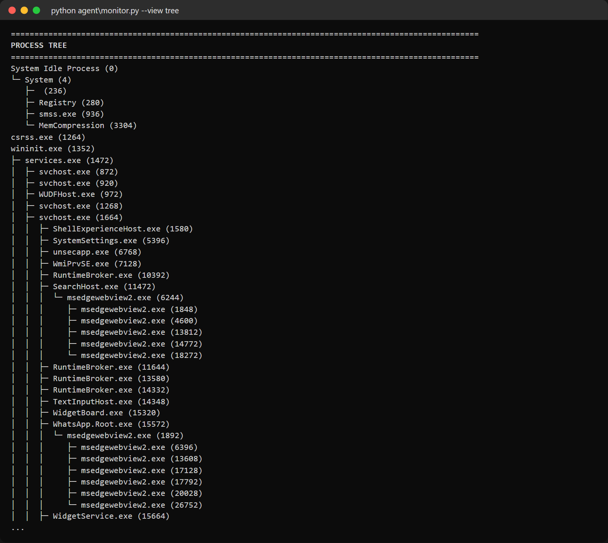
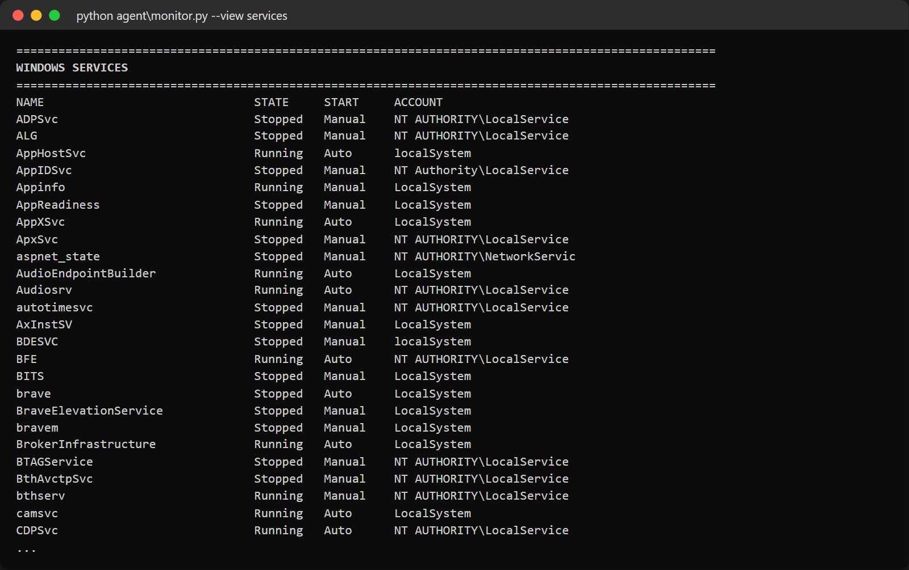
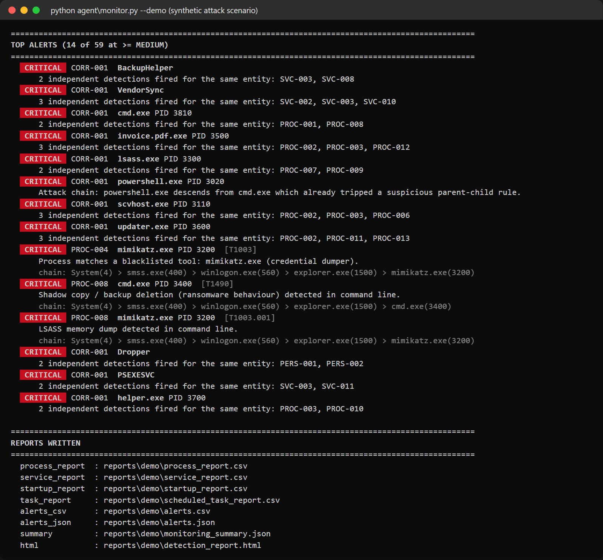
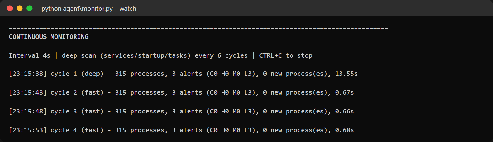
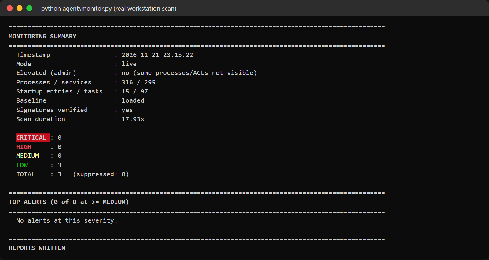
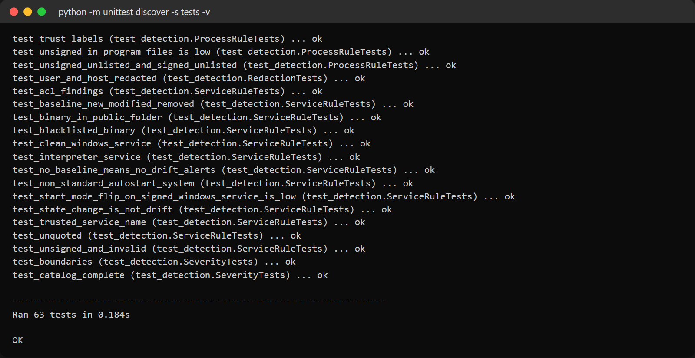

### HTML report
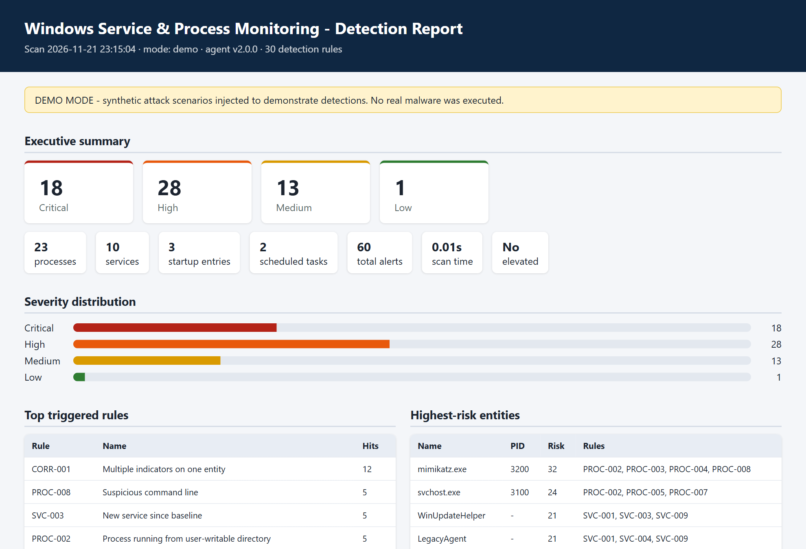

## Technologies

Python 3, psutil, pandas, Altair/Streamlit, PowerShell (CIM, Authenticode, ACL APIs), Windows Registry (`winreg`),
MITRE ATT&CK, GitHub Actions.

## Limitations

This is a user-mode, point-in-time/polling agent. It does not see kernel activity, memory injection internals, network
telemetry or ETW/Sysmon events, and an alert is an *indicator for investigation*, not proof of compromise. Production
EDR adds kernel telemetry, event-log correlation and threat-intelligence enrichment.

## Roadmap

ETW / Sysmon event ingestion, network-connection correlation, YARA scanning of flagged binaries, webhook / email
alerting, authenticated multi-host dashboard.

## Author

Developed as a cybersecurity internship project.

## Disclaimer

For defensive security monitoring, learning and authorised environments only.
