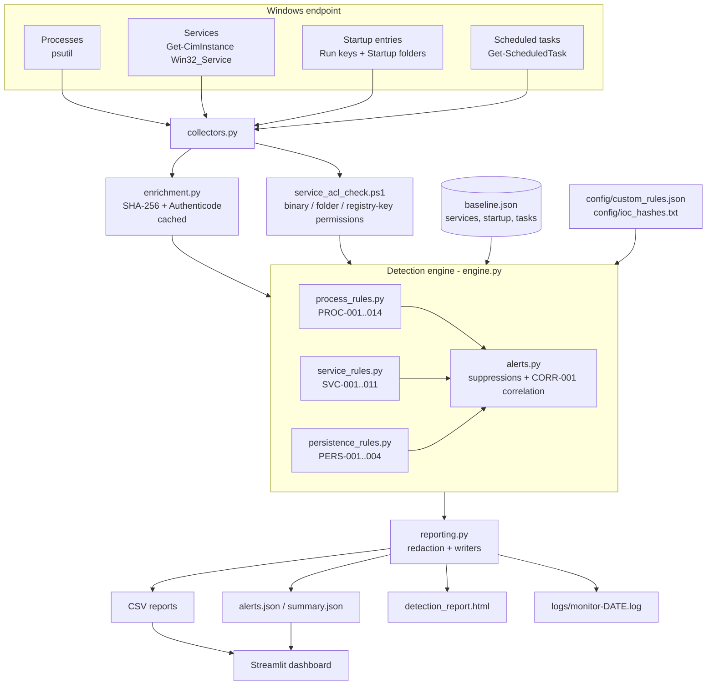

# Architecture

The agent is a pipeline: **collect → enrich → detect → correlate → report**. Every stage is a separate module so each
can be tested in isolation (`tests/`).

## Modules

| Module | Responsibility |
|---|---|
| `agent/monitor.py` | CLI: single scan, `--watch`, `--demo`, `--view`, `--update-baseline`, `--list-rules` |
| `agent/collectors.py` | Process (psutil), service (CIM), startup (winreg + `.lnk` resolution) and scheduled-task collection |
| `agent/enrichment.py` | SHA-256 and Authenticode verification with an on-disk cache keyed by size + mtime |
| `agent/rules_data.py` | Rule catalog (MITRE-mapped), allow/deny lists, parent-child matrix, command-line patterns |
| `agent/process_rules.py` | Lineage with PID-reuse protection and all `PROC-*` rules |
| `agent/service_rules.py` | `SVC-*` rules incl. baseline drift, unquoted paths, ACL weaknesses |
| `agent/persistence_rules.py` | `PERS-*` rules for startup entries and scheduled tasks |
| `agent/alerts.py` | Alert model, severity scoring, suppression, correlation |
| `agent/engine.py` | Runs all rule sets, attack-chain correlation, summary statistics |
| `agent/reporting.py` | CSV / JSON / HTML writers, history, privacy redaction |
| `agent/demo.py` | Safe synthetic attack scenario for demonstrations and tests |
| `agent/powershell/*.ps1` | Signature check, ACL audit, scheduled tasks, services, shortcut resolution |
| `dashboard/app.py` | Streamlit UI: overview, alerts drill-down, process tree, services, persistence, MITRE |

## Design decisions

* **Signature-aware allowlisting.** An allowlist alone flags every browser. Unlisted binaries only alert when they are
  *unsigned* (or from a staging directory), which cut noise on a real workstation from 183 alerts to 2-3 informational ones.
* **PID-reuse protection.** A "parent" that started after its child is a recycled PID and is ignored, so stale PPIDs do
  not create false parent-child alerts.
* **Baselines, not guesses.** "New" and "modified" services are measured against a stored baseline; drift alerts persist
  until an analyst accepts the change with `--update-baseline`.
* **Correlation.** Independent signals on the same entity (and descendants of an alerting parent) are combined into
  CORR-001 so the highest-confidence findings surface first.
* **Safe by construction.** The agent is read-only: it never terminates processes or modifies services. It excludes its
  own process tree from analysis.
* **Privacy.** Reports redact the local user and computer name by default (`--no-redact` to disable).
* **Single source of truth.** `docs/detection_rules.md` is generated from the same catalog the engine executes.
